

  <nav class="home-nav" aria-label="Homepage navigation">
    <a class="home-brand" href="https://zeshuili.github.io/">Zeshui Li</a>
    

      <a href="https://zeshuili.github.io/#about">About</a>
      <a href="https://zeshuili.github.io/#publications">Publications</a>
      <a href="https://zeshuili.github.io/#hobbies">Hobbies</a>
      <a href="https://zeshuili.github.io/#contact">Contact</a>
    

  </nav>
  <header class="profile-header">
    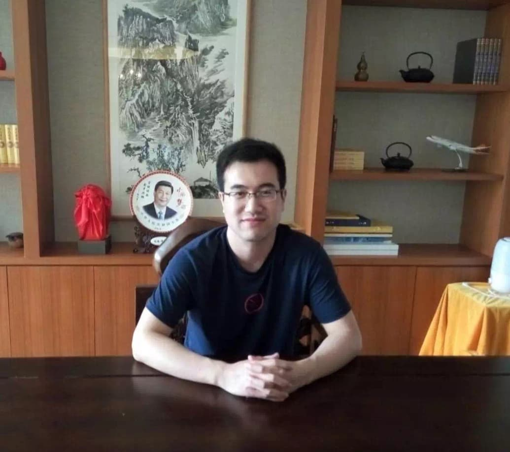
    

      <h1 class="profile-name">Zeshui Li 李泽水</h1>
      
Postdoctoral Research Fellow

      
Hong Kong

      

        Wireless Sensing
        Haptics
      

      
<a href="mailto:zeshuili@cityu.edu.hk">zeshuili@cityu.edu.hk</a>

    

  </header>
  <section id="about" class="about-section" aria-labelledby="about-heading">
    <h2 id="about-heading">About</h2>
    
This is the homepage of Zeshui Li. My research interests are <strong>Wireless Sensing</strong> and <strong>Haptics</strong>. Welcome to share your questions and ideas with me (<a href="mailto:zeshuili@cityu.edu.hk">zeshuili@cityu.edu.hk</a>).

    
I am a Postdoctoral Research Fellow at <a href="https://meilab-hk.github.io/index.html">MEI Lab</a>, supervised by Professor <a href="https://zhukening.wixsite.com/aboutme">Kening Zhu</a>. I received my Ph.D. from Nanjing University, where I was supervised by Professor <a href="http://cs.nju.edu.cn/gchen/">Guihai Chen</a> and Professor <a href="http://cs.nju.edu.cn/daihp/">Haipeng Dai</a>. During my doctoral studies, I also collaborated extensively with Professor <a href="http://cs.nju.edu.cn/ww/">Wei Wang</a>. Earlier in my career, from 2011 to 2014, I was a member of <a href="http://www.xiaoming-lab.com/">XiaoMing-Lab</a>.

  </section>
  <section id="publications" class="publications-section" aria-labelledby="publications-heading">
    <h2 id="publications-heading">Publications</h2>
    <article class="publication" aria-labelledby="pub-omnitex">
      
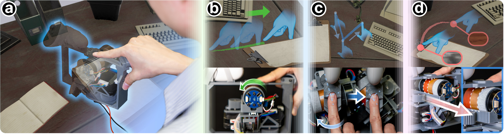

      

        <h3 id="pub-omnitex">OmniTex: Omnidirectional Haptic Rendering of Surface Texture on VR Handheld Controller using 3-DOF Motion Mechanism.</h3>
        
Tianrui Hu, Haichen Gao, <strong>Zeshui Li</strong>, and Kening Zhu.

        
<strong>ACM UIST</strong> · 2026

      

    </article>
    <article class="publication" aria-labelledby="pub-airpalm">
      
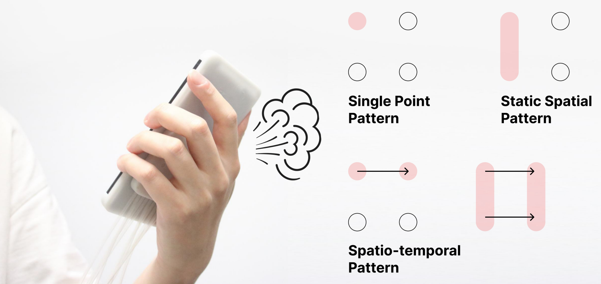

      

        <h3 id="pub-airpalm">AirPalm: Exploring Airborne Haptic Feedback from Phone-Back Airflow on the Palm.</h3>
        
Yibin Huai, Lina Zhang, <strong>Zeshui Li</strong>, and Kening Zhu.

        
<strong>ACM IMWUT(Ubicomp)</strong> · 2026

      

    </article>
    <article class="publication" aria-labelledby="pub-proxeek">
      
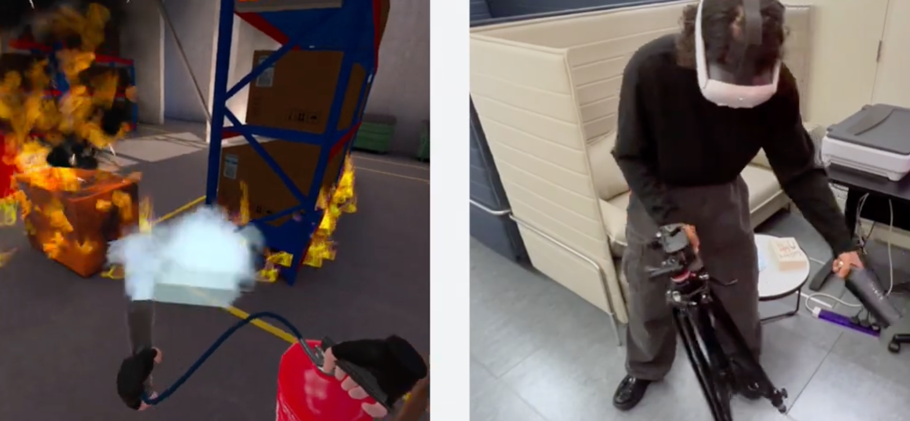

      

        <h3 id="pub-proxeek">ProXeek: Seeking and Leveraging Real-World Objects and Environments as Haptic Proxies for Virtual Reality through Multimodal Reasoning.</h3>
        
Haichen Gao, Tianrui Hu, <strong>Zeshui Li</strong>, and Kening Zhu.

        
<strong>ACM TOG &amp; ACM SIGGRAPH</strong> · 2026

      

    </article>
    <article class="publication" aria-labelledby="pub-liqmetcraft">
      
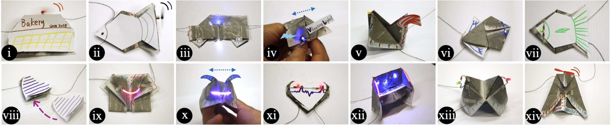

      

        <h3 id="pub-liqmetcraft">LiqMetCraft: A Toolkit for Creating Papercraft with Embedded Electronics By Directly Cutting and Folding Liquid-Metal-Dyed Paper-like Fabric.</h3>
        
Qi Zhang, Shuwen Jiang, <strong>Zeshui Li</strong>, Yong Lyu, Tiande Mo, and Kening Zhu.

        
<strong>ACM CHI</strong> · 2026

      

    </article>
    <article class="publication" aria-labelledby="pub-mpgait">
      
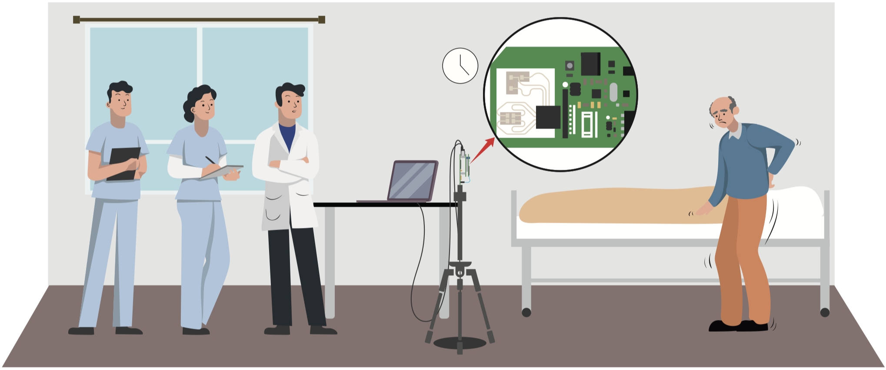

      

        <h3 id="pub-mpgait">mP-Gait: Fine-grained Parkinson’s Disease Gait Impairment Assessment with Robust Feature Analysis.</h3>
        
Wenhao Zhang, Haipeng Dai, Dongyu Xia, Yang Pan, <strong>Zeshui Li</strong>, Wei Wang, Zhen Li, Lei Wang and Guihai Chen.

        
<strong>ACM IMWUT(Ubicomp)</strong> · 2024

      

    </article>
    <article class="publication" aria-labelledby="pub-pdgait">
      
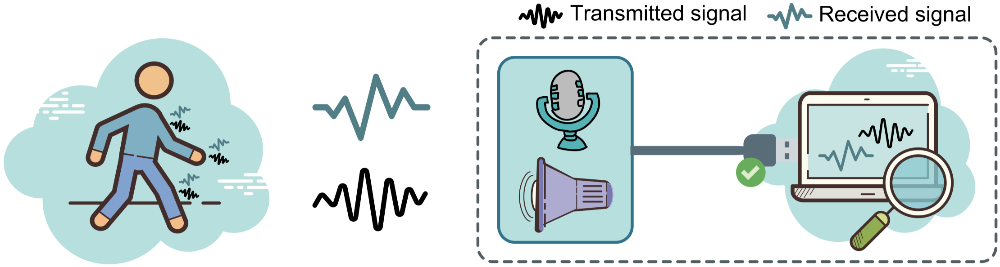

      

        <h3 id="pub-pdgait">PD-Gait: Contactless and Privacy-Preserving Gait Measurement of Parkinson's Disease Patients using Acoustic Signals.</h3>
        
<strong>Zeshui Li</strong>, Yang Pan, Haipeng Dai, Wenhao Zhang, Zhen Li, Wei Wang and Guihai Chen.

        
<strong>Software: Practice and Experience (SPE)</strong> · 2023

      

    </article>
    <article class="publication" aria-labelledby="pub-pcias">
      
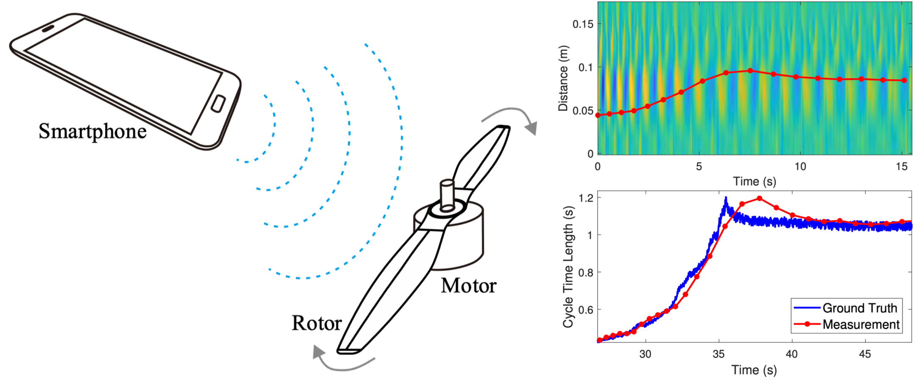

      

        <h3 id="pub-pcias">PCIAS: Precise and Contactless Measurement of Instantaneous Angular Speed using a Smartphone.</h3>
        
<strong>Zeshui Li</strong>, Haipeng Dai, Wei Wang, Alex X. Liu and Guihai Chen.

        
<strong>ACM IMWUT(Ubicomp)</strong> · 2019

      

    </article>
    <article class="publication" aria-labelledby="pub-driver">
      
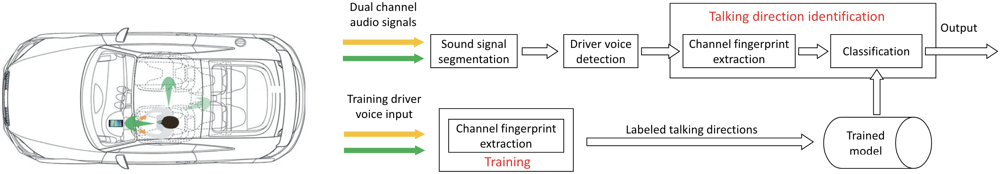

      

        <h3 id="pub-driver">Recognizing Driver Talking Direction in Running Vehicles with a Smartphone.</h3>
        
Haipeng Dai, Alex X. Liu, <strong>Zeshui Li</strong>, Wei Wang, Fengmin Zhang and Chao Dong.

        
<strong>IEEE MASS</strong> · 2019

      

    </article>
    <article class="publication" aria-labelledby="pub-transistor">
      
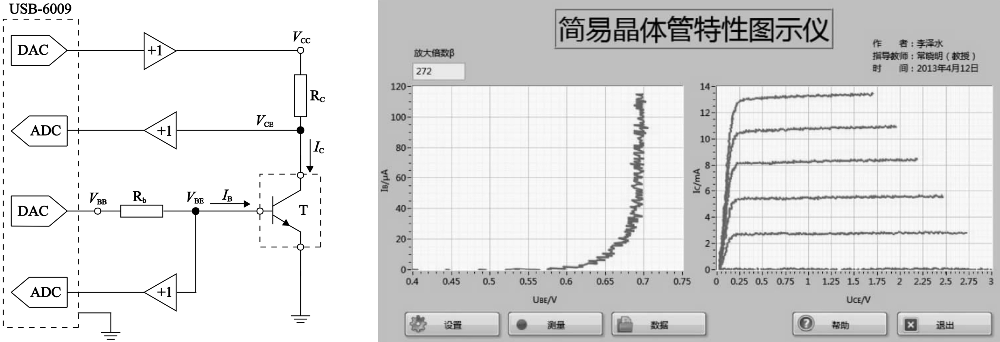

      

        <h3 id="pub-transistor">Design and Implementation of Simple Transistor Tracer Based on LabVIEW.</h3>
        
<strong>Zeshui Li</strong>, Weiling Liu, and Xiaoming Chang.

        
<strong>National Embedded Instrument and SystemTechnology Academic Conference</strong> · 2013

      

    </article>
  </section>
  <section id="hobbies" class="hobbies-section" aria-labelledby="hobbies-heading">
    <h2 id="hobbies-heading">My Hobby</h2>
    

      <article class="hobby">
        <h3>Self balancing robot</h3>
        
I'm trying to combine such robot with smartphones to build a mobile platform for smart sensing.

        
<a href="https://www.youtube.com/watch?v=_J-YQ3ySKJA&amp;list=PLxVt4lPz_cAiK9lSIy2-FKN1Th8wJ7R3r" title="My self balancing robot">See my self balancing robot at youtube.</a>

        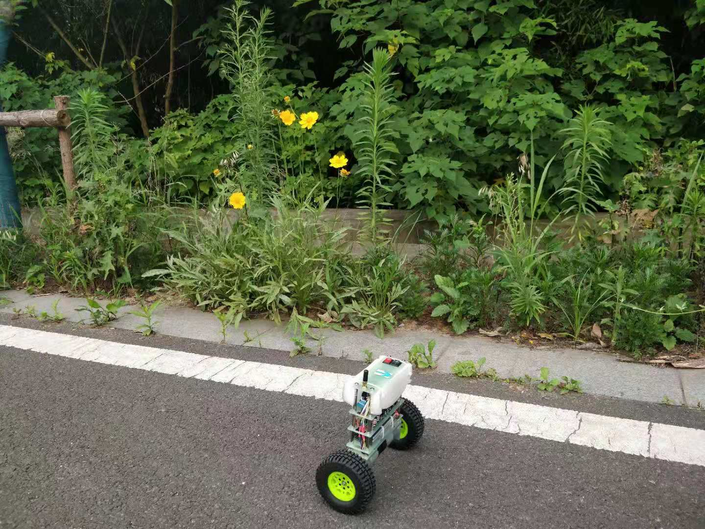
      </article>
      <article class="hobby">
        <h3>Acoustic sensing</h3>
        
Acoustic sensing in robot arm control.

        
      </article>
      <article class="hobby">
        <h3>MicroPython</h3>
        
MicroPython based on hardware platform such as Pyboard, Microbit, ESP8266 and ESP32. A NeoPixel led ring drived by ESP8266 is shown below.

        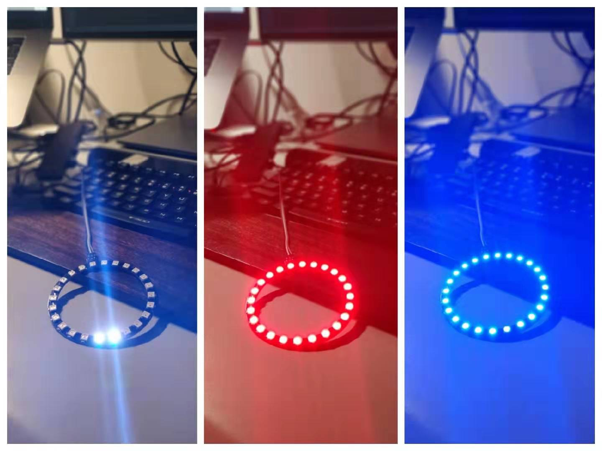
      </article>
      <article class="hobby">
        <h3>CNC machine</h3>
        
I have a personal CNC machine, which effectively meets the needs of my DIY projects.

        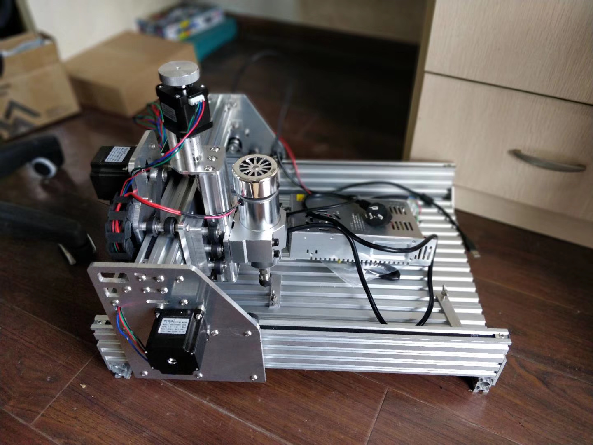
      </article>
      <article class="hobby">
        <h3>3D printer</h3>
        
The 3D printer could help me make mechanical parts for the self-balancing robots and toys for my children.

        
      </article>
    

  </section>
  <footer id="contact" class="home-footer">
    Zeshui Li · Hong Kong
    <a href="mailto:zeshuili@cityu.edu.hk">zeshuili@cityu.edu.hk</a>
  </footer>

